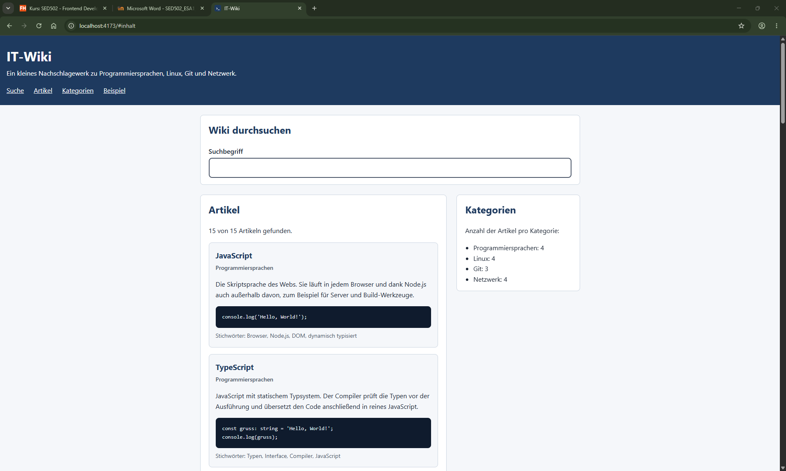

# IT-Wiki

Einsendeaufgabe 1 im Fach Front-End Development (SED502).
Projekt: Ein kleines, statisches Wiki mit 15 Einträgen zu **Programmiersprachen, Linux, Git und Netzwerk**. Die Einträge lassen sich per Live-Suche filtern.
Author: Lorenz Siedler, 01631760
Datum: 19.10.2026

## Was die Webseite zeigt



- **Suche:** Das Suchfeld filtert die Artikel beim Tippen nach Titel, Kategorie und Stichwörtern. Mehrere Suchwörter müssen alle passen. Groß-/Kleinschreibung und Akzente werden ignoriert.
- **Artikel:** Jeder Eintrag zeigt Titel, Kategorie, Zusammenfassung, ein Code-Snippet (zum Beispiel "Hello, World!") und Stichwörter. Eine Statusmeldung nennt die Trefferanzahl.
- **Kategorien:** Eine Seitenleiste zählt die Artikel pro Kategorie.
- **Beispiel:** Ein Git-Beispiel als Abbildung mit Beschriftung.

## Technische Entscheidungen

### Semantisches HTML und Barrierefreiheit

- Kein `<div>`. Verwendet werden `header`, `nav`, `main`, `section`, `aside`, `figure`, `figcaption`, `footer` und `article` für jeden Wiki-Eintrag.
- Die Navigation hat ein `aria-label` ("Hauptnavigation"). Die Abschnitte sind per `aria-labelledby` mit ihrer Überschrift verbunden.
- Die Trefferanzahl ist ein `role="status"` mit `aria-live="polite"`, damit Screenreader Änderungen der Suche ansagen.
- Skip-Link, sichtbarer Tastaturfokus und Farben mit ausreichendem Kontrast.
- Das Layout ist responsiv: Auf kleinen Bildschirmen stehen die Bereiche untereinander, ab 48 rem stehen Artikel und Kategorien nebeneinander.
- Lighthouse Accessibility: 100 (siehe `lighthouse.png`).

### TypeScript

- `tsconfig.json` ist mit `"strict": true` konfiguriert. Die Vite-Vorlage aktiviert das nicht von selbst.
- `src/daten.ts`: Interface `Artikel` (mit optionalem Feld `beispiel`), Union Type `Kategorie` und die Daten.
- `src/logik.ts`: Funktionen ohne DOM-Zugriff, mit typisierten Parametern und Rückgabewerten: `normalisiere`, `filtereArtikel` (`filter`, `every`) und `zaehleKategorien` (`reduce`).
- `src/main.ts`: DOM und Events. Die Liste wird bei jeder Eingabe komplett aus dem Array neu gerendert.
- Inhalte werden mit `textContent` statt `innerHTML` eingefügt, damit Eingaben nicht als HTML interpretiert werden.
- `holeElement<T>()` prüft, ob ein Element existiert, und wirft sonst eine verständliche Fehlermeldung statt `!` zu verwenden.

### Aufbau

Vite mit der Vorlage `vanilla-ts`, ohne Framework.

## Projekt starten

Voraussetzung: Node.js (LTS).

```bash
npm install
npm run dev      # Entwicklungsserver
npm run build    # Typprüfung (tsc) und Produktions-Build
npm run preview  # gebauten Stand lokal ansehen
```

## Struktur

```text
index.html       semantisches Gerüst
src/main.ts      DOM und Events
src/logik.ts     Suchen, Filtern, Zählen
src/daten.ts     Interface Artikel und Wiki-Einträge
src/style.css    Layout und Styling
```
